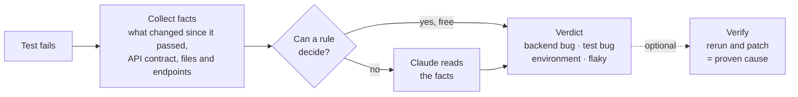

# Redline

When a Playwright test fails, the first question is always the same: **is it a bug in the app, a bug
in the test, or is the server just down?** Redline answers it for every failure, automatically.

```
[redline] run #12 · 8 Okt 2026, 19.36 WIB: 40 lulus, 9 gagal, 0 flaky, 1 skip
  9 kegagalan dari 2 penyebab

  #  INSIDEN                    TEST  STATUS     KATEGORI     PENYEBAB
  1  POST /users/login → 500       8  BARU       BUG BACKEND  API membalas 500 padahal test…
  2  TC-USR-001 Register user      1  REGRESSED  BUG DI TEST  Test memeriksa objek response…
```

_Output after `npx playwright test` (the report is in Indonesian). 9 failures, 2 causes, each explained._

## What it does

- **Groups failures.** The same failure over ten runs is one problem; 300 tests failing because the server is down is one cause.
- **Explains each cause**: backend bug, test bug, environment or flaky. Free rules first, Claude only when needed.
- **Proves it on request** by rerunning the test and patching it in a copy of your project.
- **Knows how tests connect**: which files and endpoints each test uses, so it can tell you which tests a change affects.
- **Redacts secrets** (tokens, passwords, JWTs, card numbers) before anything is stored or sent to AI.

## How it works



## Accuracy

Measured with bugs planted on purpose, using Claude Haiku 5.5:

| Scenario                                 | Correct         | Wrong guesses |
| ---------------------------------------- | --------------- | ------------- |
| New test, no history (24 bugs)           | 92–96%          | 0             |
| Test that passed before (24 bugs)        | 96–100%         | 0             |
| App upgrade: outdated test vs regression | 6/6             | 0             |
| Shared helper, schema or endpoint        | 18/18, by rules | 0             |

When unsure, Redline says "unclear" instead of guessing. The benchmark lives in the
[Playwright project](https://github.com/ega-septian/playwright-web-api-automation) (`npm run redline:bench`).

## Quick start

Requires Go 1.24+ and Docker.

```bash
cp .env.example .env
docker compose up -d   # Neo4j (DozerDB): bolt://localhost:7688, browser http://localhost:7475
go run ./cmd/server    # API on http://localhost:8787
```

Optional settings in `.env` (Redline works without them, with less insight):

| Setting             | Adds                                                                                         |
| ------------------- | -------------------------------------------------------------------------------------------- |
| `ANTHROPIC_API_KEY` | AI analysis and patches. Without it, only rules are used                                     |
| `VOYAGE_API_KEY`    | Matches past proven cases with a similar error ([Voyage AI](https://dashboard.voyageai.com)) |
| `OPENAPI_SPECS`     | Your API contract, e.g. `toolshop=http://localhost:8091/docs`                                |

## Connect your Playwright project

1. Copy from [playwright-web-api-automation](https://github.com/ega-septian/playwright-web-api-automation):
   `reporters/redline.ts`, `reporters/source-hash.ts`, `fixtures/redline.ts`, and for the CLI
   `scripts/redline.mts` and `scripts/sandbox.mts`.
2. Add the reporter after the JSON reporter in `playwright.config.ts`:
   ```ts
   reporter: [["html"], ["json", { outputFile: "test-results/results.json" }], ["./reporters/redline.ts"]],
   ```
3. Import `test` from the fixture in your specs (it records response shapes and a curl per request):
   ```ts
   import { test, expect } from "../../../fixtures/redline";
   ```
4. Give each test an ID: `test("...", { tag: "@TC-USR-001" }, ...)`. It appears in reports, and keeps
   a test's history when you rename its title, `describe` or file.

Run your tests as usual. The full report, with a curl to reproduce each failed request, is written to
`test-results/redline-report.md`. If Redline is down, tests still run normally.

## Commands

From your Playwright project:

| Command                                            | What it does                                         |
| -------------------------------------------------- | ---------------------------------------------------- |
| `REDLINE_AI=1 npx playwright test`                 | Run tests and explain each failure                   |
| `node scripts/redline.mts verify`                  | Prove the cause of the last run's failures           |
| `node scripts/redline.mts impact schemas/brand.ts` | Tests affected by a file (or `impact GET /brands/1`) |
| `node scripts/redline.mts score`                   | How often Redline's guesses turned out right         |
| `node scripts/redline.mts learn`                   | Turn proven cases into rules; then `approve <id>`    |

| Environment variable  | Effect                                                  |
| --------------------- | ------------------------------------------------------- |
| `REDLINE_URL`         | Server address, default `http://localhost:8787`         |
| `REDLINE_VERIFY=1`    | Prove each new failure right after the run (local only) |
| `REDLINE_APP_VERSION` | Version of the app under test, e.g. `sprint2`           |
| `REDLINE=0`           | Turn Redline off                                        |

## How it decides

Redline tries the cheapest, most reliable source first:

1. **A human label**, if someone already labelled the failure.
2. **Proof** from an earlier `verify`.
3. **Rules**, free and instant: server unreachable → environment; 5xx → backend bug; missing `await`
   → test bug; response breaks the API contract → backend bug; plus rules you approved.
4. **Claude**, with the redacted error, test code, response shapes, API contract and what changed.
   Every piece of evidence must be quoted from those facts, or the confidence is lowered.

The strongest signal is **what changed since the test last passed**:

| Test code | API response | API contract         | Verdict                         |
| --------- | ------------ | -------------------- | ------------------------------- |
| same      | changed      | same                 | **backend bug** (regression)    |
| same      | changed      | changed the same way | **test bug** (test is outdated) |
| changed   | same         | —                    | **test bug**                    |

**Knowledge graph.** Tests, the files they import (however deep) and the endpoints they call are
stored as a graph in Neo4j. That catches what a single test can't show: a shared schema two imports
deep that changed, or an endpoint failing for unrelated tests too. More in [`docs/kag.md`](docs/kag.md).

## Proving a cause

`verify` turns a guess into proof, in a temporary copy of your project (your code is never touched):

1. **Rerun** the test as is. If it passes now, it's flaky.
2. **Patch**: Claude proposes the smallest fix and the test runs again. If it passes, the cause is proven.

The patch is saved to `test-results/redline/<id>.patch` to review. Patches that remove assertions or
add `skip`, `try/catch` or retries are rejected. About $0.001 per verify.

## What is sent

| Data                                                           | When              |
| -------------------------------------------------------------- | ----------------- |
| Test results, error messages, code around the error            | every run         |
| File paths and content hashes of the test code and its imports | every run         |
| Response shapes: field names and types, **no values**          | with the fixture  |
| **Source code of failed tests**                                | failed tests only |

Everything is redacted before it is stored. With AI on, the redacted facts go to Claude and redacted
error messages to Voyage AI.

## Team settings

| Setting          | Default        | Meaning                                                      |
| ---------------- | -------------- | ------------------------------------------------------------ |
| `STATUS_FROM`    | `ci`           | Which runs may open or close a failure: `ci`, `local`, `all` |
| `RETENTION_DAYS` | `30`           | Old test details are cleaned up (`0` = never)                |
| `TIMEZONE`       | `Asia/Jakarta` | Time zone for the API and logs                               |

Only CI changes a failure's status by default, so a half-written test on a laptop doesn't become a
team failure. Working alone? Use `STATUS_FROM=all`.

<details>
<summary><b>API</b></summary>

| Endpoint                                                           | Purpose                                                        |
| ------------------------------------------------------------------ | -------------------------------------------------------------- |
| `POST /api/runs`                                                   | Send a Playwright JSON report                                  |
| `GET /api/runs`                                                    | Recent runs                                                    |
| `GET /api/groups`                                                  | Open failures (`?status=all` for every failure)                |
| `GET /api/groups/{id}`                                             | One failure: occurrences, experiments, analysis                |
| `POST /api/groups/{id}/analyze`                                    | Find the cause (`?force=1` to redo)                            |
| `PUT /api/groups/{id}/label`                                       | Label it: `{"label": "test_bug", "note": "...", "by": "name"}` |
| `GET /api/groups/{id}/knowledge`                                   | Graph facts behind a decision                                  |
| `POST /api/groups/{id}/fix`, `.../experiments`                     | Used by `verify`                                               |
| `GET /api/rules`, `POST /api/rules/propose`, `PUT /api/rules/{id}` | Learned rules                                                  |
| `GET /api/scoreboard`                                              | How often guesses matched the proof                            |
| `GET /api/impact?file=...` or `?endpoint=...`                      | Tests affected by a file or endpoint                           |
| `GET /healthz`                                                     | Health check                                                   |

Labels: `backend_bug`, `test_bug`, `environment`, `flaky`, `unknown`.

No reporter? Post the JSON report yourself:
`curl -X POST "http://localhost:8787/api/runs?source=local" --data-binary @test-results/results.json`

</details>

<details>
<summary><b>Development</b></summary>

```
cmd/server/          HTTP server
internal/report/     reads Playwright JSON reports
internal/triage/     redaction, grouping, shared causes
internal/analysis/   rules, AI, experiments, learning
internal/contract/   OpenAPI checks
internal/embed/      Voyage AI client
internal/llm/        Claude client
internal/store/      Neo4j graph model, queries, retention
internal/api/        HTTP handlers
```

```bash
REDLINE_TEST_NEO4J_URI=bolt://localhost:7688 go test ./...   # without it, database tests are skipped
```

Tests create and empty their own databases (`redlinetest-*`); never point them at a server with real
data. No real AI calls are made in tests.

</details>

## Versions

| Version  | Highlights                                             |
| -------- | ------------------------------------------------------ |
| `v0.3.1` | A renamed test keeps its history through its `@TC-` ID |
| `v0.3.0` | Knowledge graph and impact analysis                    |
| `v0.2.0` | Neo4j (DozerDB) as the only database                   |
| `v0.1.0` | First release, Postgres + pgvector                     |

## What's next

- **ReportPortal integration**: read "To Investigate" items, write back the defect type and proven patch.
- Analyse errors that stop a spec from loading (syntax errors, broken imports).
- An inferred contract for APIs without documentation.
