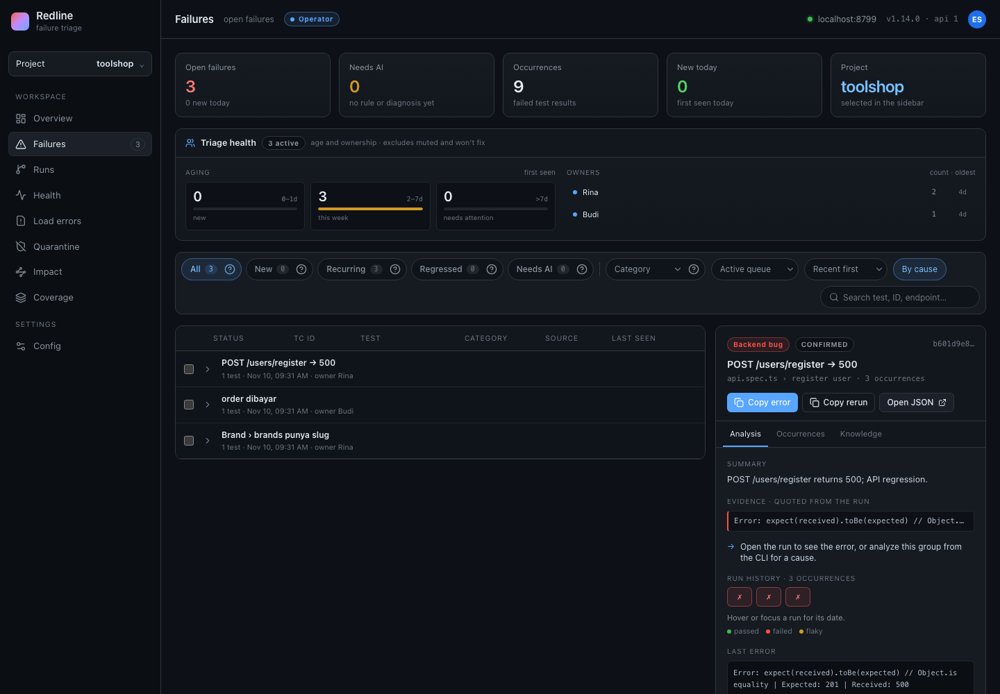
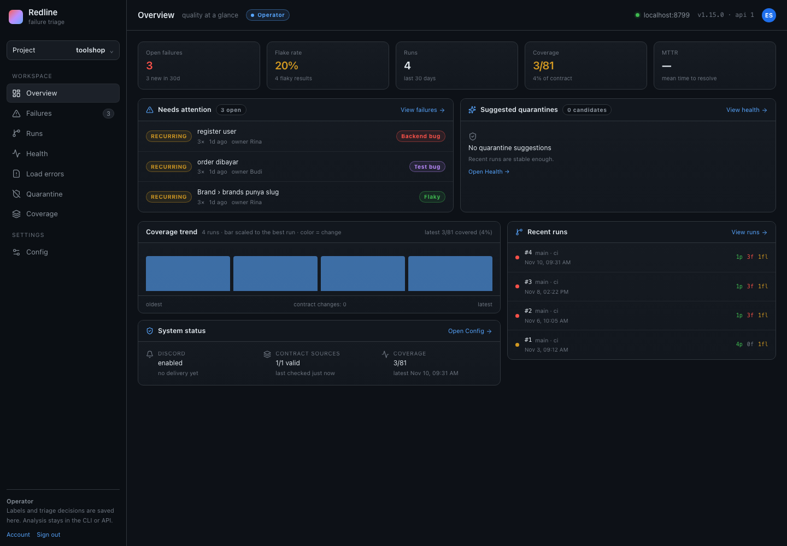
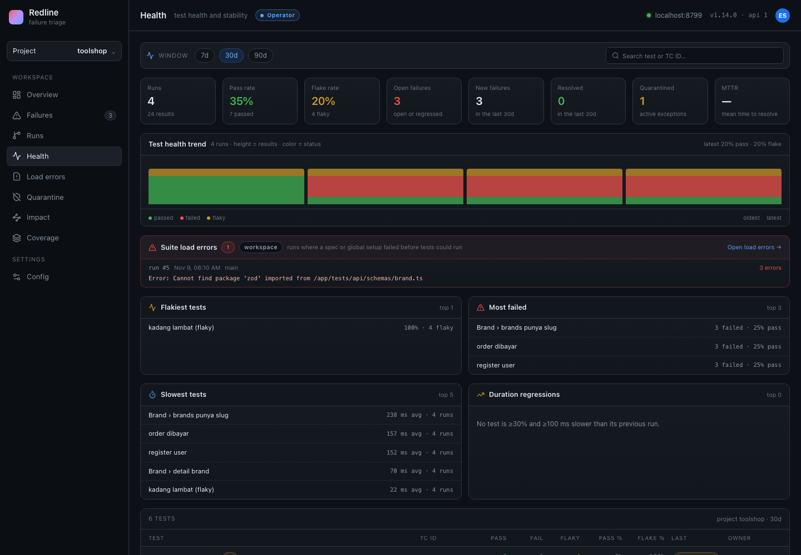
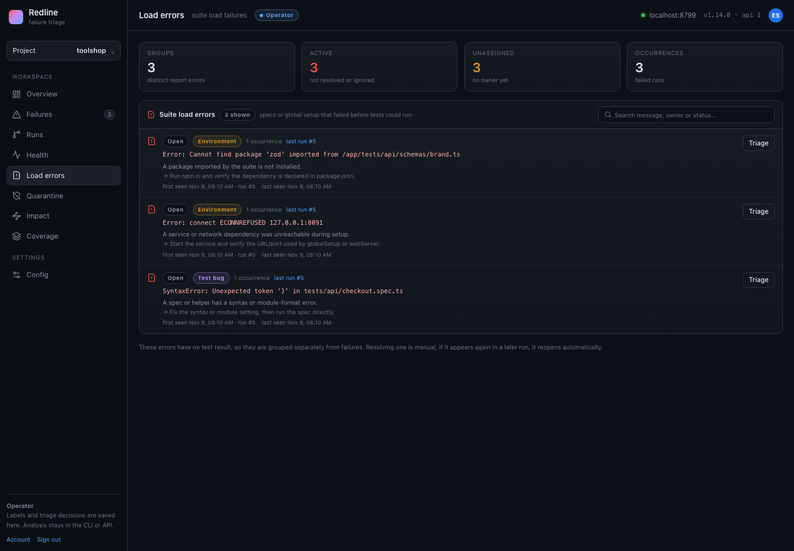
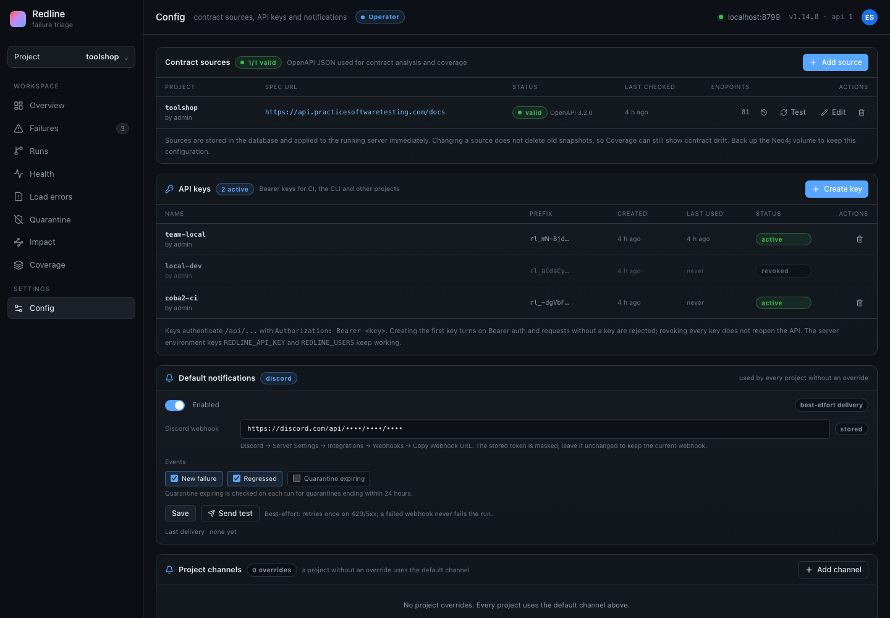

# Redline

[](https://github.com/ega-septian/redline/actions/workflows/ci.yml)
[](https://github.com/ega-septian/redline/releases)
[](LICENSE)

**Failure triage for Playwright.** Redline groups failing tests, finds the likely cause, and shows the
evidence — backend bug, test bug, environment or flaky — before you open the trace.



## Why Redline?

- **One problem, not 50 failures.** Duplicate errors become one incident with a run history.
- **Evidence, not a guess.** Every cause comes with the error, response shape, contract diff and a curl
  to reproduce it.
- **Knows what changed.** Tests, imports and endpoints are stored as a graph, so Redline can separate a
  backend regression from an outdated test.
- **Rules first, AI optional.** Deterministic rules run free on every run; Claude is only asked when the
  rules cannot decide.
- **Tracks the suite over time.** Flake rate, slow tests, quarantines, contract coverage and impact.

## A quick look

| Overview | Test health |
| --- | --- |
| [](docs/screenshots/overview.png) | [](docs/screenshots/health.png) |
| Open failures, recent runs and coverage at a glance. | Pass/flake trends, slow tests and regressions. |

| Suite load errors | Config and API keys |
| --- | --- |
| [](docs/screenshots/load-errors.png) | [](docs/screenshots/config.png) |
| Broken imports and setup failures, grouped separately. | Contract sources, keys and notifications. |

[See all screenshots →](docs/screenshots/README.md)

All screenshots use demo data; no production data is included.

## Quick start

### 1. Run the server

Requires **Go 1.24+** and **Docker**.

```bash
git clone https://github.com/ega-septian/redline.git
cd redline
cp .env.example .env
docker compose up -d      # Neo4j / DozerDB
go run ./cmd/server       # http://localhost:8787
```

Check that the process and database are ready:

```bash
curl localhost:8787/healthz
curl localhost:8787/readyz
```

Open <http://localhost:8787/ui/> and create the first admin account.

Or run everything in Docker:

```bash
export REDLINE_API_KEY=$(openssl rand -hex 32)
docker compose --profile full up -d --build
```

`REDLINE_API_KEY` is the machine key for the reporter and CLI. The UI uses the admin username and
password. Create a separate key per project in **Config → API keys**.

### 2. Connect a Playwright project

```bash
npm i -D github:ega-septian/redline#v1.14.1
```

Add the reporter after the JSON reporter in `playwright.config.ts`:

```ts
reporter: [
  ["html"],
  ["json", { outputFile: "test-results/results.json" }],
  ["redline-playwright/reporter"],
],
```

Use the fixture so Redline can record response shapes, imports and a curl per request:

```ts
import { test, expect } from "redline-playwright/fixture";

test("Register user", { tag: "@TC-USR-001" }, async ({ request }) => {
  const response = await request.post("/users/register", { data: payload });
  expect(response.status()).toBe(201);
});
```

Run the tests:

```bash
npx playwright test
```

If the Redline server is down, the tests still run normally.

Optional AI analysis on the server:

```bash
ANTHROPIC_API_KEY=sk-ant-...
AI_DAILY_BUDGET_USD=5
```

### 3. Give CI a key

Open **Config → API keys**, create a key, and copy it once. Then set:

```dotenv
REDLINE_URL=https://redline.example.com
REDLINE_API_KEY=rl_...
```

Full deployment and GitHub Actions guides: [deploy](docs/deploy.md) and [PR comments](docs/github-action.md).

## What you get

- **Failures and triage** — grouped failures, owner, status, aging, run history and evidence.
- **Runs and comparison** — every run, changed tests, retries and artifacts.
- **Test health** — pass/flake rate, flips, slowest tests, duration regressions.
- **Suite load errors** — failures before a test can run, classified by cause.
- **Quarantine** — owner, reason, expiry calendar and evidence-based suggestions.
- **Coverage and impact** — contract endpoints vs calls, affected tests.
- **Config** — contract sources, API keys and Discord notifications.

[Feature details →](docs/features.md)

## How it works

1. The reporter sends the Playwright JSON, response shapes and the import graph.
2. Redline groups failures by cause, then checks the cheapest source: human diagnosis, proof, rules, AI.
3. A human confirms the result; Redline uses it to improve future analyses.

More about the graph: [Knowledge graph](docs/kag.md).

## Configuration

Everything has a working default. The settings you are most likely to change:

| Setting | Default | Meaning |
| --- | --- | --- |
| `HOST` | `127.0.0.1` | Interface to bind. A non-loopback host requires an API key. |
| `PORT` | `8787` | HTTP port. |
| `REDLINE_API_KEY` | empty | Bootstrap key for `/api/...`. |
| `STATUS_FROM` | `ci` | Which runs may open or close a failure: `ci`, `local`, `all`. |
| `RETENTION_DAYS` | `30` | Delete old test details and artifacts (`0` = never). |
| `TIMEZONE` | `Asia/Jakarta` | Time zone for responses and logs. |
| `MAX_REPORT_MB` | `50` | Largest accepted Playwright report. |
| `ARTIFACT_DIR` | `./artifacts` | Trace and screenshot storage. |
| `ANTHROPIC_API_KEY` | empty | AI analysis and patches; empty = rules only. |
| `AI_DAILY_BUDGET_USD` | `0` | Stop AI calls after this daily budget. |
| `VOYAGE_API_KEY` | empty | Find similar past proven cases. |

Full list and examples: [`.env.example`](.env.example).

## Commands

| Command | What it does |
| --- | --- |
| `REDLINE_AI=1 npx playwright test` | Run tests and explain each failure. |
| `npx redline verify` | Prove the cause of the last run's failures. |
| `npx redline impact schemas/brand.ts` | Tests affected by a file or endpoint. |
| `npx redline score` | How often Redline's guesses were right. |
| `npx redline comment` | Create or update a sticky PR comment. |
| `npx redline analyze --run 112` | Analyze an existing run without rerunning tests. |

## Troubleshooting

| Symptom | Fix |
| --- | --- |
| Cannot connect to Neo4j | `docker compose up -d`, then check `docker compose ps`. |
| Server exits on a non-loopback host | Set `REDLINE_API_KEY`, or use `HOST=127.0.0.1`. |
| `server tidak bisa dihubungi` in test output | Start Redline, set `REDLINE_URL`, or disable with `REDLINE=0`. |
| Reporter warns about an API version mismatch | Use the same tag for the server and `redline-playwright`. |
| Database tests are skipped | Set `REDLINE_TEST_NEO4J_URI=bolt://localhost:7688`. |

## Documentation

- [Screenshots](docs/screenshots/README.md)
- [Feature details](docs/features.md)
- [Privacy and data handling](docs/features.md#privacy)
- [API reference](docs/api.md)
- [Deploy on Render or a VPS](docs/deploy.md)
- [GitHub Actions PR comment](docs/github-action.md)
- [Development](docs/development.md)
- [Roadmap](docs/roadmap.md)
- [Knowledge graph](docs/kag.md)
- [Releases](https://github.com/ega-septian/redline/releases)

## License

[MIT](LICENSE) © 2026 Ega Septian
