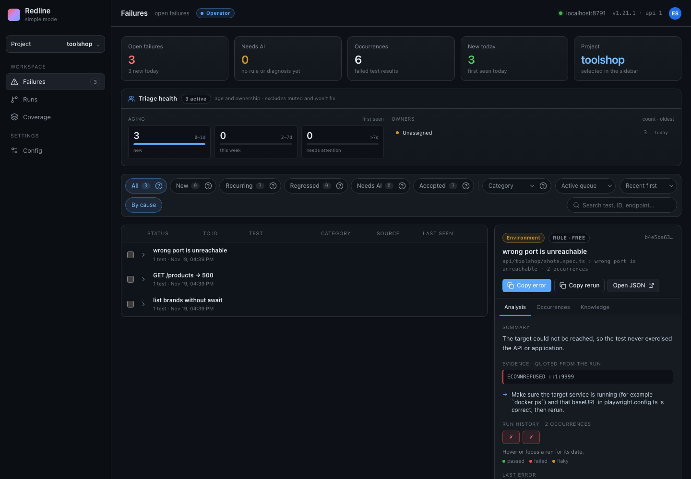
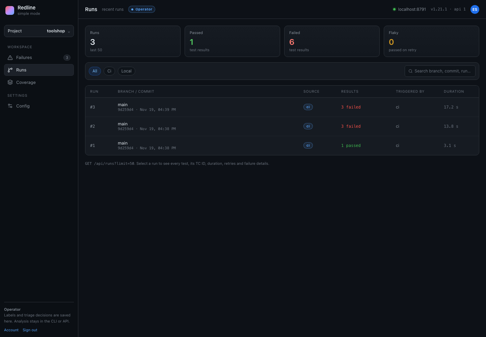
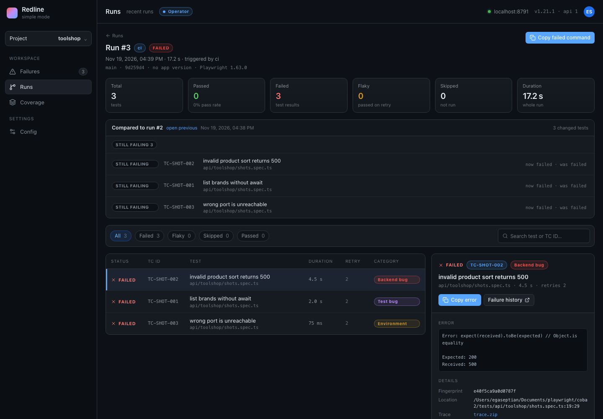
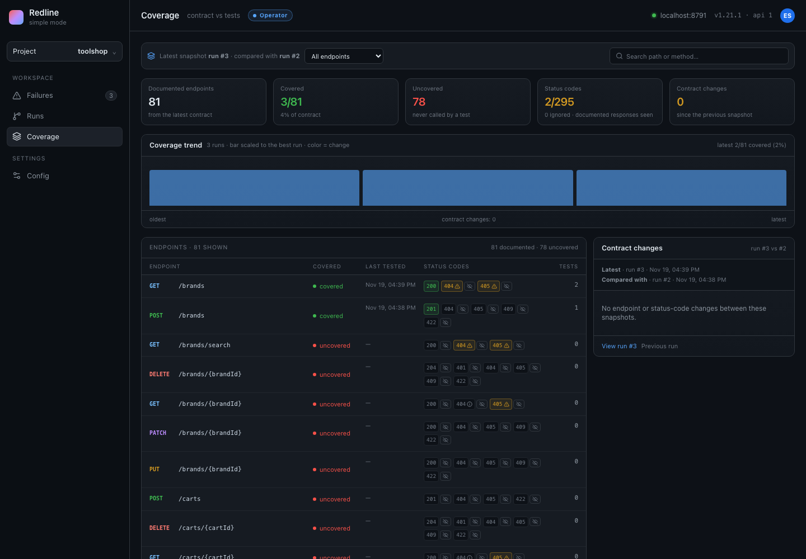
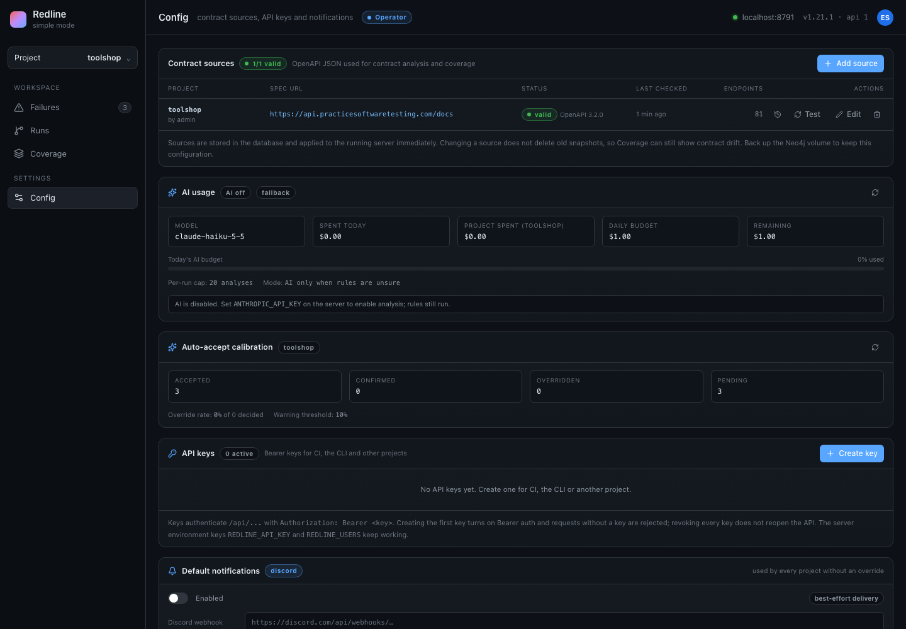

# Screenshots

These screenshots use a small demo project (`toolshop`) with three runs and three failure groups. Names and webhook URLs are demo data.

## Failures

Failures are grouped by cause. The right panel shows the summary, quoted evidence, run history and the actions to copy the error, rerun the test or open the JSON.

## Runs

Every uploaded run with its branch, commit, source, result counts and duration.

## Run detail

A single run shows the comparison with the previous run, changed tests, failures, retries and artifacts.

## Coverage

Documented OpenAPI endpoints compared with the calls recorded by the Playwright fixture, including status codes, hints, ignored codes and contract changes.

## Config

Contract sources, AI usage and cost, API keys and notifications — all stored in Neo4j and applied without a restart.

---

The screenshots are generated from the real UI against a demo database. To reproduce them, run the server and use the same demo data; no production data is included.
