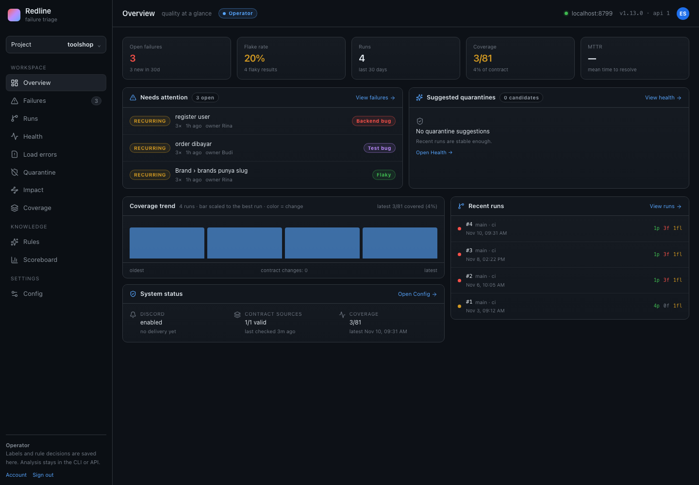
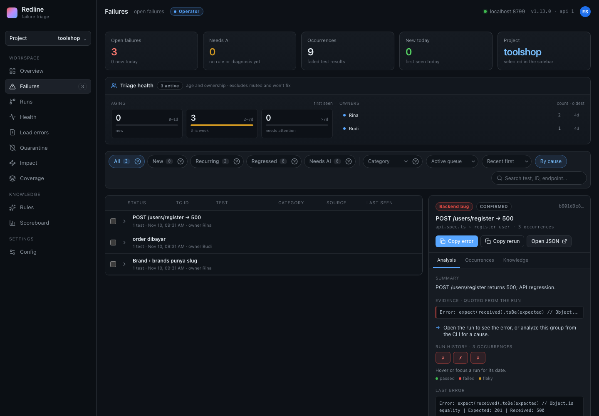
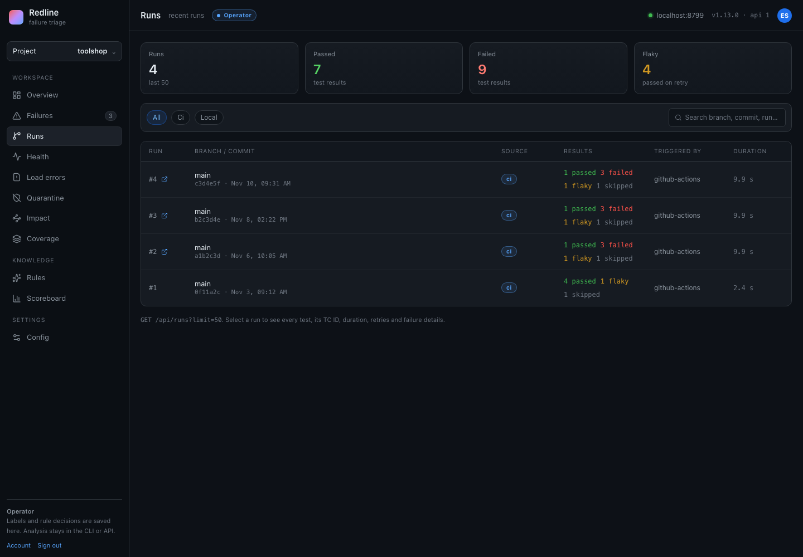
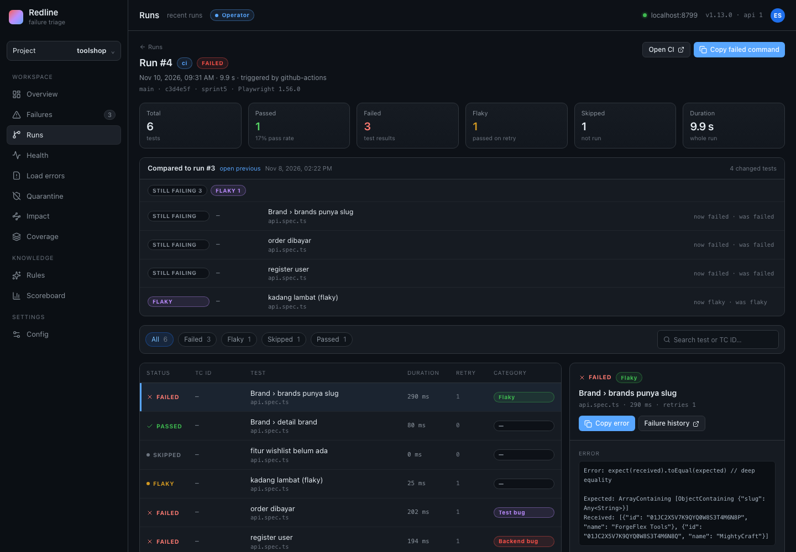
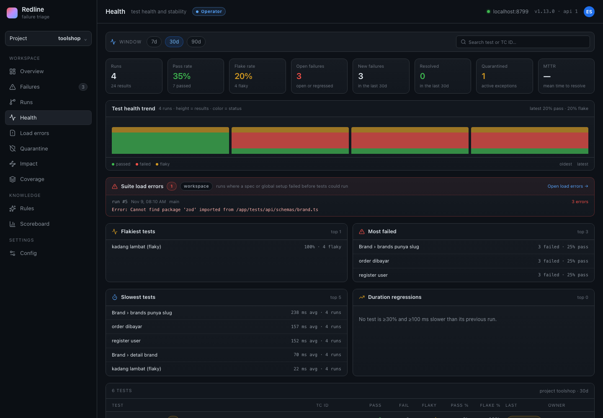
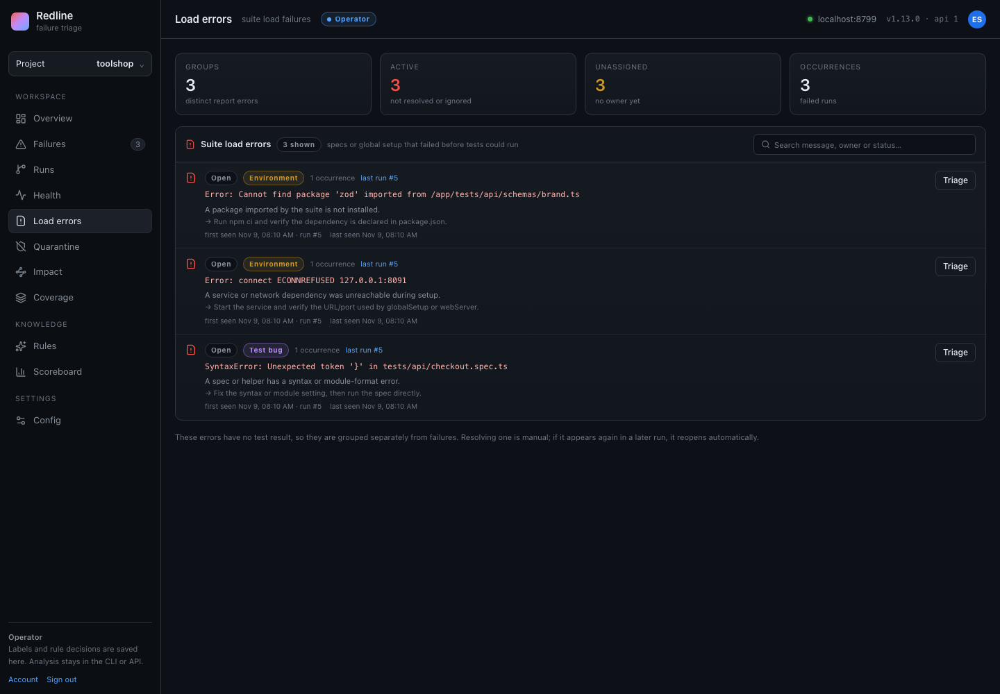
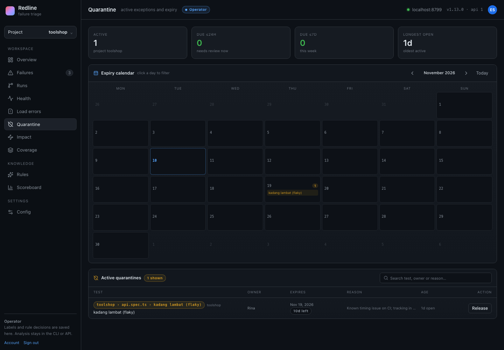
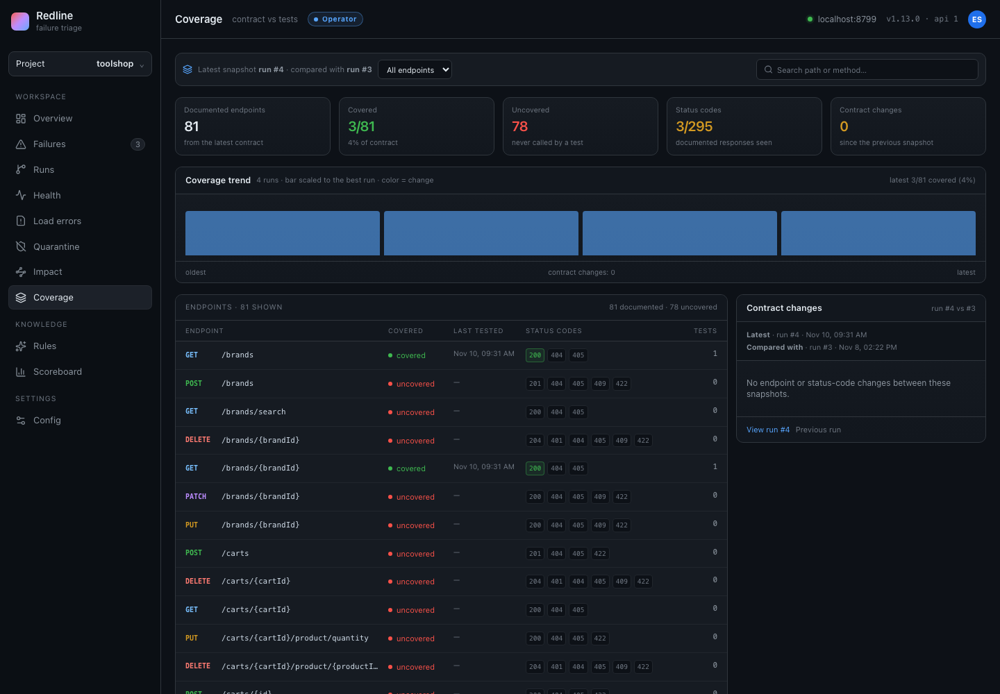
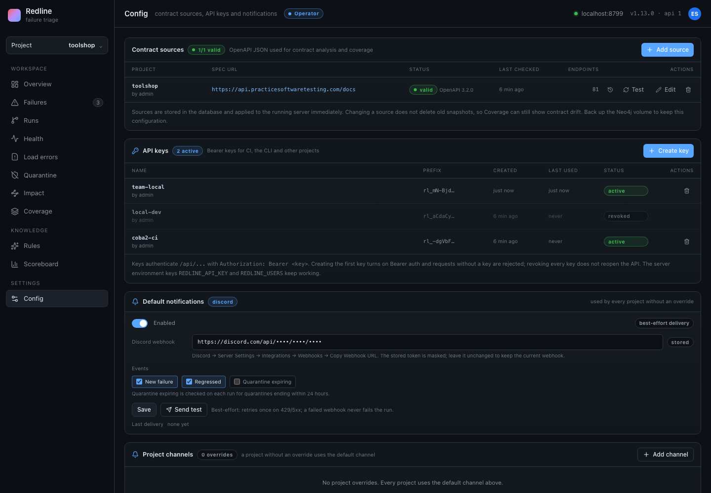

# Screenshots

These screenshots use a small demo project (`toolshop`) with four runs, three failure groups, a quarantine and three suite load errors. Names such as Rina, Budi and the webhook are demo data.

## Overview

Open failures, flake rate, recent runs, contract coverage and the quarantine suggestions in one place.

## Failures and triage

Failures are grouped by cause. The right panel shows the summary, quoted evidence, run history and the actions to copy the error, rerun the test or open the JSON.

## Runs

Every uploaded run with its branch, commit, source, result counts and duration.

## Run detail

A single run shows the comparison with the previous run, changed tests, failures, retries and artifacts.

## Test health

Pass/flake trends, slowest tests, most failed tests and duration regressions for the selected window.

## Suite load errors

Errors that happen before a test can run — missing packages, broken imports, syntax errors or an unreachable service — are grouped and classified separately from test failures.

## Quarantine

Active exceptions with an owner, reason and expiry. The calendar marks the days when quarantines end.

## Coverage

Documented OpenAPI endpoints compared with the calls recorded by the Playwright fixture, including status codes and contract changes.

## Config

Contract sources, API keys for CI and other projects, and Discord notifications — all stored in Neo4j and applied without a restart.

---

The screenshots are generated from the real UI against a demo database. To reproduce them, run the server and use the same demo data; no production data is included.
